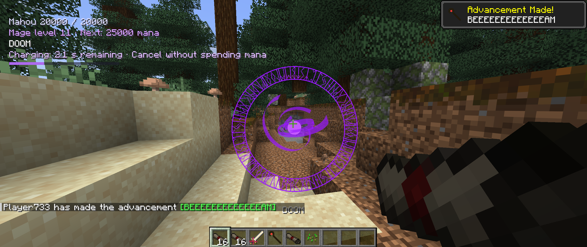
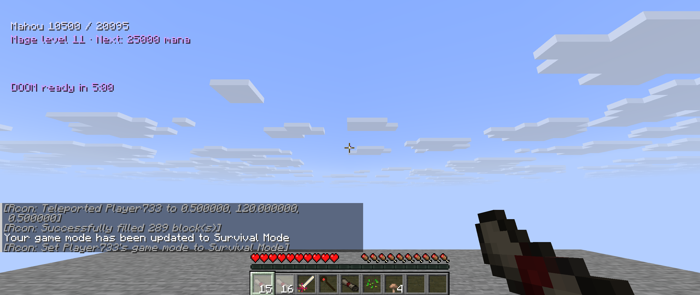
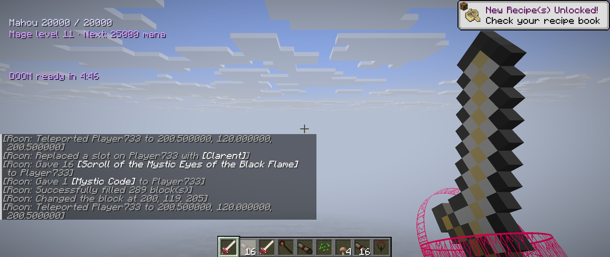
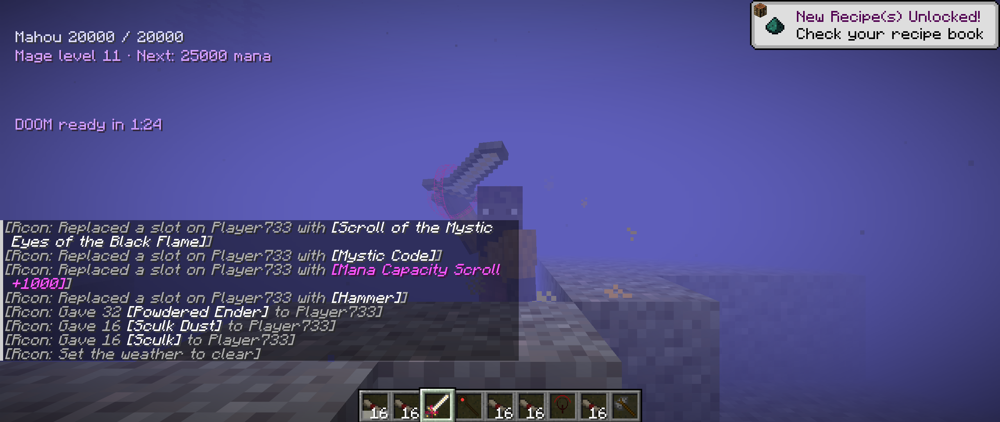
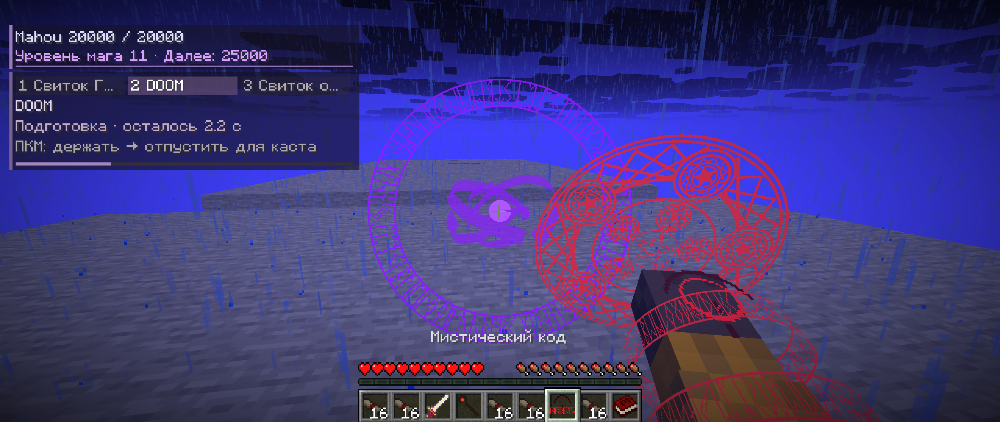
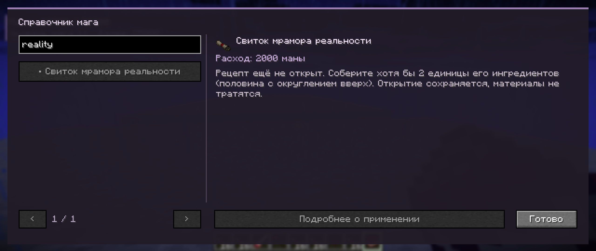
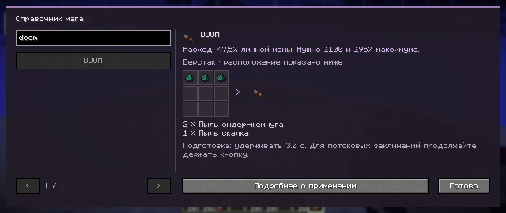
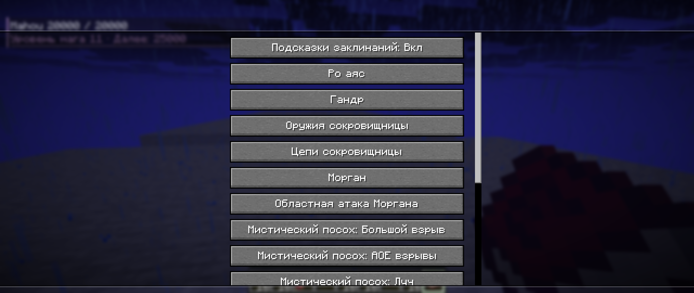

> Historical report for this version. Current behavior and verification: [QA-0.30.md](QA-0.30.md).

# Проверки обновления 0.26 — 18 октября 2026

Проверен кандидат `1.36.36-fabric.0.26-incomplete`. Изменения баланса намеренно отличаются от оригинала.

## Автоматические проверки

- Сборка JAR и встроенные проверки: PASS. Проверены миграция трёх старых настроек, сохранение точной резервной копии и пользовательских настроек, повторная загрузка.
- Общий серверный набор: PASS (`analysis/phase026-server-checks.log`). Экономика, регенерация, семейства заклинаний, оружие, сущности, озеро, сохранение, DOOM и его граница перезарядки.
- Сравнение с неизменённым оригинальным NeoForge JAR: 1 372 сочетания компонентов ритуалов; 53 рецепта, 87 исходных предметных контрактов, 37 эффектов и 27 сущностей.
- Боевой набор: 15 440 случаев. 12 ожидаемых изменений из-за постоянной силы Clarent проверяются отдельно численными утверждениями. Допустимая разница только округления здоровья — до 0,00001 HP. Случайность выпадения экипировки при смерти зафиксирована одинаково в обеих версиях; исходный тест повторно выполнен на оригинале.
- Новый серверный набор: PASS (`analysis/phase026-final-verification.log`). Половинные цены, точные переводы маны, отмена и неудачные применения, ограничения Mystic Code, пять свитков ёмкости, предел маны, уровни, фактическое поедание еды и отмена, сон, остановка чёрного пламени, постоянная сила Clarent, ключи 130, Nobu 100.
- Проверены настоящий крафт DOOM и открытие его рецепта, крафт пыли скалка и наличие возврата молота.
- 3 000 сундуков с фиксированным источником случайности: маленькие свитки маны выпадают существенно чаще +1000; исходный ванильный лут сохраняется.
- Emrys: фактические серверные тики, дождь под открытым небом и отсутствие преобразования под крышей.
- Jousting и Apotheosis Adventure Fabric 0.2.1: общий набор и отдельные интеграционные проверки PASS (`analysis/phase026-optional-checks.log`). У Apotheosis есть предупреждение о необязательном `artifacts:swim_speed` без мода Artifacts; не объявляем эту строку исправленной.
- Готовый производственный JAR дважды запущен с Fabric API без тестовых классов. Копия мира NeoForge загрузилась; 321 маны в батарее и блок в Reality Marble сохранились после остановки/перезапуска. Исходный мир не изменён.

## Живая клиентская проверка

- Интерфейс показывает ману, уровень, название заклинания, секунды подготовки и шкалу.
- DOOM: фиолетовый круг подготовки отображается; ранняя отмена сохранила 20 000 маны и 16 свитков, сущность подготовки исчезла.
- Завершённый DOOM в survival: 20 000 → 10 500 маны; интерфейс показал 5:00 перезарядки. Рост максимума до 20 095 после расхода — существующая естественная прокачка.
- Нативный FogRenderer и синхронизированные чанки озера: PASS, расстояние 4,777897, дальность тумана 4.
- Через клиентскую обработку нажатия X отправлен пакет остановки: сервер снял чёрное пламя, мана осталась 20 000. Подсказка проверена в русском интерфейсе.
- Туман возле настоящего блока воды озера отображается. Золотые частицы Clarent при силе 600 видны в третьем лице.
- У реальной серверной сущности луча посоха прочитано `MAHOUTSUKAI_BEAM_LENGTH: 128.0f`; клиентский эффект отображается.

## Тестовая игра

Отдельный мир `mahou-026-sandbox`, локальный сервер `127.0.0.1:25585`, игрок `Player733`. Другие миры и запущенный пользователем клиент не заменялись. Выданы DOOM, Gandr, Clarent, посох в режиме луча, Fallen Down, чёрное пламя, Mystic Code, свитки маны и ингредиенты DOOM.

- DOOM: удерживать ПКМ 3 секунды, отпустить в направлении цели. После запуска 8 секунд роста, затем взрыв. Рецепт бесформенный: две пыли эндер-жемчуга и одна пыль скалка.
- Чёрное пламя: X выключает взгляд. Уже созданный огонь сохраняется по правилам огня. Также выключается Shift+ПКМ его свитком.
- Fallen Down: Shift+ПКМ меняет режим; обычную ПКМ удерживать минимум 2,6 секунды и продолжать держать для действия. Отпускание прекращает заклинание.
- Посох: Shift+ПКМ переключает три режима; в режиме луча удерживать ПКМ до завершения подготовки.
- Свиток ёмкости: обычный ПКМ. Для проверки стоимости использовать survival; creative пропускает расходы.

## Границы проверки

Это конечные воспроизводимые наборы, а не доказательство всех возможных ситуаций Minecraft. Не выполнялись многопользовательский нагрузочный прогон нескольких DOOM, проверка каждого заклинания со всеми сторонними модами/шейдерпаками и субъективная оценка каждого звука/анимации. Новая клиентская сцена проверена без внешнего шейдерпака.

SHA-256 JAR: `81640a430a9cd35c30ae39a0d78e998906f7fea8c96e8768690b32cbf72b75dd`.

## Интерактивная книга и подсказки Mystic Code

Дополнение проверено 18 октября 2026. В справочнике есть поиск по названию/ID, схемы обычного крафта, компоненты ритуалов и сведения о расходе маны. Для Gandr расход пересчитывается от текущего максимума игрока, для DOOM показана доля личной маны, для Fallen Down — периодический расход. Переменные цены не объявляются бесплатными: книга обозначает зависимость от режима/цели и даёт переход к исходному описанию.

Свитки раскрываются при наличии половины требуемых единиц ингредиентов, с округлением вверх; дубликаты учитываются количественно, лишний запас одного ингредиента не заменяет другие. Ткань учитывается, если обязательна. Для DOOM достаточно двух пылей эндер-жемчуга либо одной пыли эндер-жемчуга и одной пыли скалка. Найденный свиток сам по себе не раскрывает рецепт. Открытия хранятся на сервере отдельно для каждого игрока, сохраняются при загрузке и копируются после смерти; ингредиенты при открытии не расходуются. Creative показывает все страницы.

Нативный серверный тест проверил пороги 1/3, 2/3, 2/4, запрет замены разных ингредиентов избытком одного, реальное открытие DOOM, сохранение после удаления ингредиентов и сериализацию/загрузку игрока. В игре просмотрены закрытый рецепт Reality Marble и открытый крафт DOOM; поиск и переход по страницам работают.

Подсказки показывают три слота Mystic Code, выделение выбранного, полное название активного заклинания, требуемое время до каста и обратный отсчёт со шкалой. Они работают и для обычного свитка в руке, появляются до начала каста, по умолчанию включены. Клиентская настройка SHOW_CAST_HINTS сохраняется в mahoutsukai-fabric-client.json и недоступна серверу для переопределения. В настройках мода (клавиша «.» по умолчанию) первый пункт — «Подсказки заклинаний». Нативный клиентский тест вызвал реальный обработчик этой кнопки, проверил скрытие, сохранение false при повторной загрузке настроек и включение обратно.

Каталог обычных крафтов берётся из активных серверных ресурсов мода; поддержаны исходные shaped/shapeless-рецепты с явными ID ингредиентов. Неподдерживаемая сторонняя структура рецепта отмечается в серверном журнале, не заменяется выдуманной схемой. Подробные исходные описания могут содержать старые формулировки баланса; актуальная цена показывается на странице нового каталога. Рецепты без обычного верстака отмечены как ритуал/особое получение/добыча.

Итоговый JAR с книгой и подсказками SHA-256: `ae5503b7dbaeb095c01cf8af78231a360687251a51f7c949676f710633a0aaa0`. Повторный запуск и перезапуск готового JAR прошли (analysis/phase026-guide-packaged.log).
