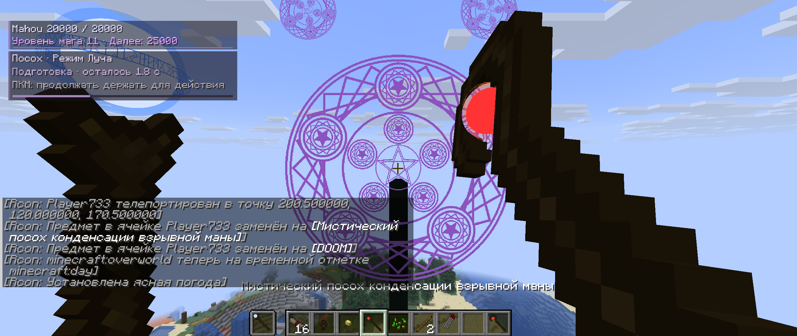
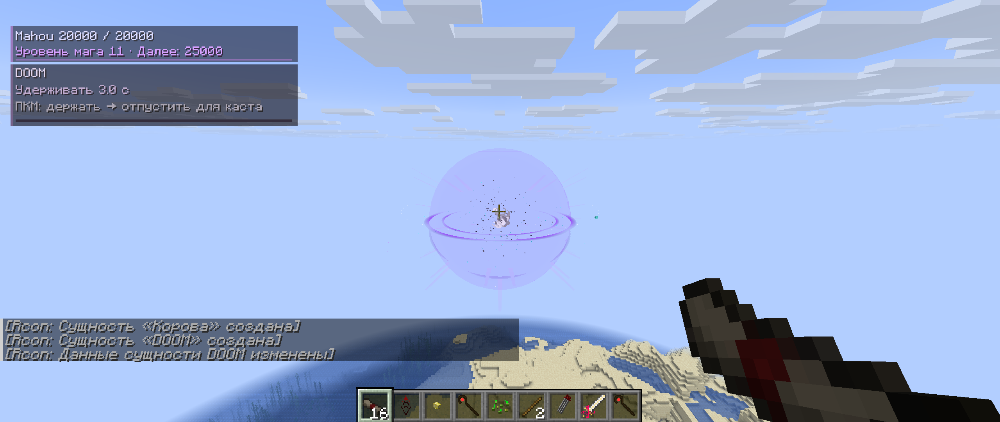
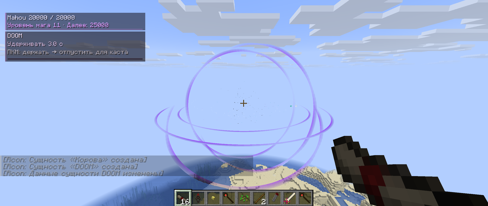

> Historical report for this version. Current behavior and verification: [QA-0.30.md](QA-0.30.md).

# Обновление 0.27 — 19 октября 2026

## Изменения

- DOOM притягивает живых мобов и игроков в пределах 96 блоков во время подготовки, включая creative. Spectator исключён. Радиус поражения остаётся 60, разрушения блоков — 40. Притяжение учитывает реальную физику и столкновения; стены не становятся проходимыми.
- Ландшафт уничтожается целиком в первом такте детонации. Нет очереди по 512 блоков. Бедрок, неразрушимые блоки и отмена от защиты территории сохраняются; новые чанки ради взрыва не загружаются. Восемь секунд подготовки сохранены.
- Вместо частиц разрушения каждого блока: отдельная вспышка, световые лучи, частицы, дым, расширяющаяся оболочка и три наклонных ударных кольца. Эффект затухает за три секунды.
- Панель маны и подсказок уменьшена до 82% прежнего размера. Положение настройки сохраняется; другие проекционные интерфейсы не масштабируются вместе с ней.
- Посох конденсации показывает режим и время подготовки: большой взрыв — 5,3 с; бомбардировка — интервал из серверной настройки; луч — 2,7 с. Для потоковых режимов подсказка предлагает продолжать удерживать кнопку.
- Clarent: временная часть силы уменьшается вдвое за 1200 игровых тактов (минута при 20 TPS). Треть каждого рассеянного количества переходит в постоянную память. Пример: 300 временной силы → 150 временной + 50 памяти = 200 общего урона после минуты; при полном рассеивании остаётся 100 памяти.
- Общая сила и урон удара Clarent ограничены 1600, включая копируемую силу оружия цели. Старые слишком сильные мечи ограничиваются при обновлении/применении. Старое стандартное значение настройки 500000 меняется на 1600 с резервной копией; меньший пользовательский предел сохраняется.
- Память и время последнего рассеивания хранятся в компонентах конкретного предмета; копирование и сохранение меча сохраняют память. На сервере рассеивание работает в инвентаре, а не только при удержании меча.

## Проверки

- Сборка и встроенные проверки PASS: analysis/phase027-final-build.log.
- Нативные проверки половины/повторного затухания, постоянного остатка, копирования и сериализации памяти Clarent, старой силы выше предела, реального ограничения удара и подготовки посоха PASS.
- Нативные проверки притяжения мобов, survival/creative игроков, исключения spectator и внешнего радиуса PASS. Проверено не только значение скорости: настоящий тик моба сдвинул его к центру.
- Общий серверный набор, включая сравнение с оригиналом, сохранение, прежние заклинания и DOOM PASS: analysis/phase027-dense-clean.log. Сохранены 12 ожидаемых исходных различий Clarent при сравнении; временное затухание отдельно проверяется новым набором.
- Плотный массив 31×31×31 = 29791 блок проверен в изолированном тестовом мире: все восемь октантов исчезли в первом такте детонации, защищённая точка и бедрок сохранились. Детонация заняла 81,6 мс на этом компьютере. Это замер конкретной сцены, не гарантия отсутствия паузы на другом сервере или при полном объёме сферы.
- В живом клиенте новая панель и обратный отсчёт луча отображаются. Игрок с начальной координаты X=478,5 сдвинулся к центру X=400 до X=474,17 за 1,1 с. Обычная корова с X=480,5 сдвинулась до X=470,58 за 2 с. Моб NoAI в дополнительной сцене использовался как неподвижный контроль; позиционное доказательство получено на обычном мобе.
- Живой тик инвентаря обновил тестовый Clarent с временной силой 300 и отметкой на минуту раньше: общая сила 198,74, память 50,63 с учётом дополнительных игровых тактов.
- Готовый JAR + Fabric API без тестовых классов запущен дважды. Копия старого мира загрузилась; батарея и Reality Marble сохранились после перезапуска. Исходный мир не менялся: analysis/phase027-packaged.log.

При проверках обнаружены и исправлены два дефекта тестовых сцен: незагруженная область для моба и каменный массив от незавершённого предыдущего запуска, перекрывавший линию прицеливания других проверок. Утверждения не ослаблялись: физика проверяется после загрузки чанков, массив изолирован и очищается перед повтором.

Версия остаётся экспериментальной. Одновременная нагрузка нескольких полных DOOM и все сторонние моды/шейдерпаки в этом обновлении не проверялись.

SHA-256 JAR: `9f97f10d88e155bf9490ed7f5b0baba269e7c26edb54a2e195f2da439cfd5818`.
