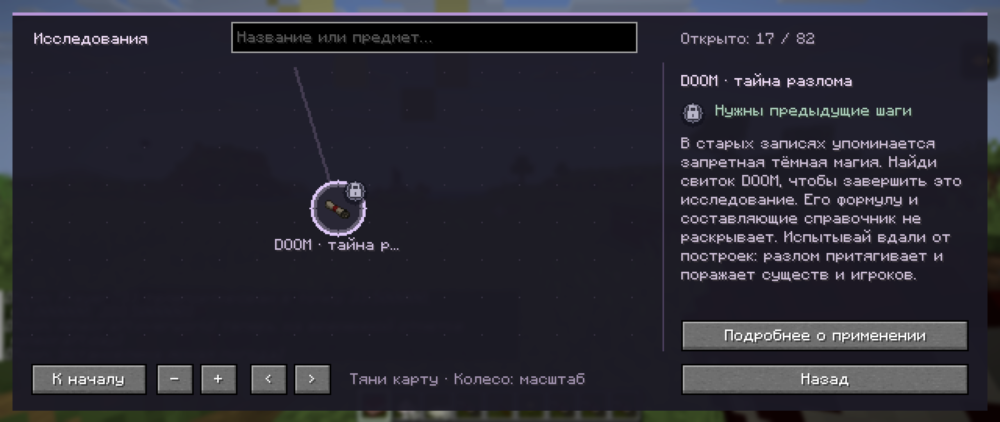
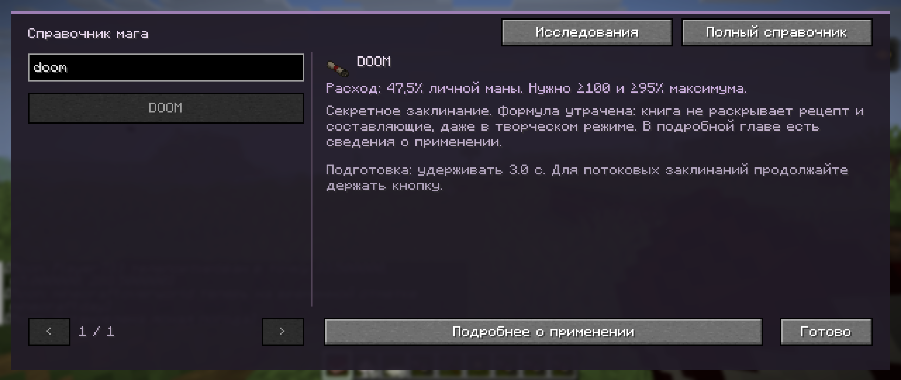
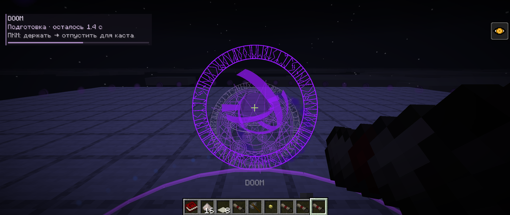
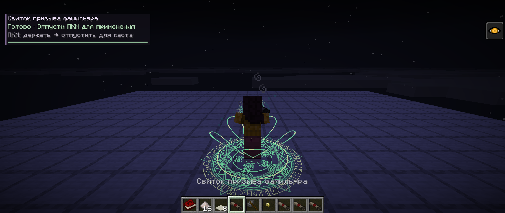
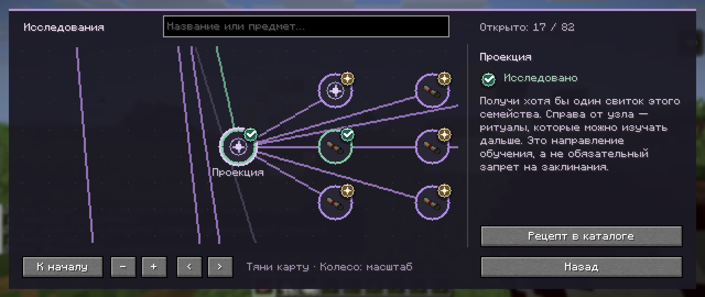

# 0.30 — тайное исследование DOOM и новая активация магии

## Изменения

- Все 45 свитков получили отдельные звуки подготовки и успешной активации: 90 синтезированных OGG. Для посоха и свитков расширения маны сохранены 18 семейных звуков. Появление и детонация DOOM используют запись, описанную в [SOUND-SOURCES.md](SOUND-SOURCES.md).
- Активация использует 12 объёмных мотивов: цветок, глаз, защитный каркас, клинки, разлом, цепи, корона, пламя, копьё, парные петли, затмение и орбиты. У каждого свитка задан мотив, цвет и устойчивые отличия геометрии. После успешного применения печать расширяется и затухает за две секунды.
- Геометрия ограничена восемью видимыми заклинателями и восемью завершающими эффектами. Частицы имеют общий бюджет 360 за такт, при минимальных настройках — 80. Собственный каст получает приоритет; уменьшенная детализация учитывает настройку частиц.
- Узел DOOM остаётся виден как «тайна разлома». Он не связан с ингредиентами. Сетевая карточка содержит только описание, без составляющих и схемы. Это действует также в creative.
- Реальный бесформенный крафт сохранён. Vanilla не получает recipe display и не добавляет рецепт в книгу даже после крафта или выдачи рецептов; старое знание удаляется. Текущий JEI 29.47.0.111 отфильтровывает special recipes, отдельная категория мода DOOM не регистрирует.
- Формула опубликована отдельно: [спойлер на GitHub](../../docs/DOOM-SECRET-RECIPE.md). Это скрытие игровых подсказок, а не защита от изучения исходников или распаковки JAR.
- Исследования используют нарисованные медальоны, галочки, искры и замки. Ритуалы без предмета получили отдельный символ. В справочнике сохранены поиск, масштабирование и переходы.
- Исправлена ошибка приоритета битовых операций в RGB-цвете статусных эффектов: например, прозрение теперь использует `0xCCCC8C`, а не чёрный цвет.

## Проверки

- `build`, `visualCheckClasses`, `runProgressionChecks`, `runEconomyChecks` выполнены на текущих исходниках. Проверяются реальные игровые классы и миры, с обязательными свежими маркерами завершения.
- Сервер проверил 15 440 боевых случаев, 1 372 ритуальные перестановки и 53 семейства. Сохранены 12 явно ожидаемых отличий заряда Clarent. В 16 случаях здоровье отличается менее чем на 0,00001 HP.
- Исправленные цвета 37 эффектов являются намеренным визуальным отличием от оригинала. Сравнение проверяет явную таблицу исходных и новых цветов; остальные поля эффектов остаются строгими. При повторном запуске исправлена также тестовая сцена дождя: усиленная палка теперь выдаётся после установки крыши, чтобы автоматическое превращение до начала проверки не искажало результат. Проверки дождя и крыши сохранены.
- DOOM: все три перестановки бесформенного рецепта, неполный набор, фактическое взятие результата из `ResultSlot`, расход ингредиентов и отсутствие раскрытия рецепта; скрытое содержимое карточки в survival и creative. Обычное открытие остальных рецептов сохранено.
- Проверены 90 уникальных файлов и событий звука свитков, семейные звуки, отображение обоих событий DOOM на запись фильма, сериализация визуального события и граф из 82 исследований. Добавлены регрессионные проверки RGB-каналов.
- В живом клиенте все 110 событий приняты штатным звуковым движком. Реальные методы построения геометрии всех 45 свитков выполнены через 180 вызовов: все 12 мотивов, конечные координаты, ограниченные размеры мешей и минимальная детализация.
- Вручную просмотрены игровые снимки подготовки и активации, тайной карточки DOOM и древа. Проверены поиск, масштабирование и возврат из исследований в каталог.
- Готовый JAR с Fabric API, без тестовых классов, дважды запущен на копии старого NeoForge-мира. Батарея и Reality Marble сохраняются после перезапуска; исходный мир не изменён.

Это экспериментальная версия. Автоматическая проверка геометрии всех свитков не заменяет художественную оценку каждого эффекта. В этом обновлении не повторялся полный набор сторонних интеграций, не проверялась нагрузка нескольких одновременных DOOM на слабом сервере и не заявляется совместимость со всеми шейдерпаками.

## Снимки из игры

