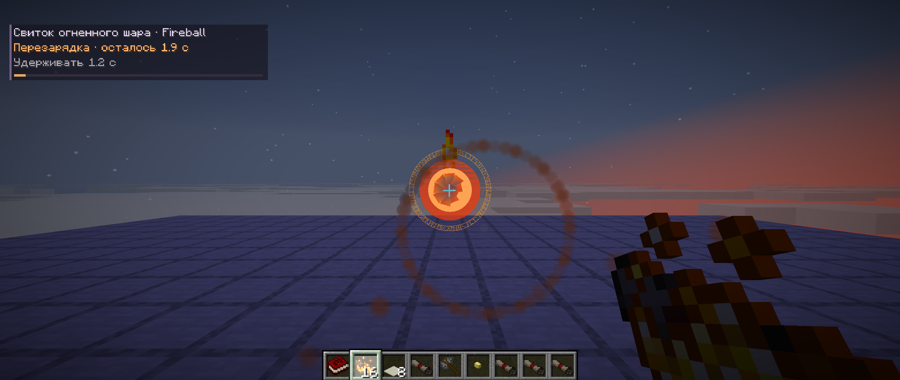
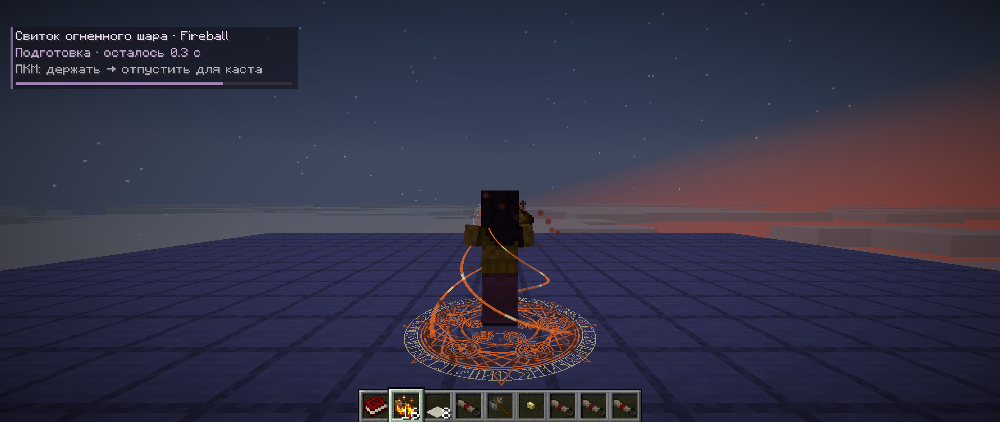
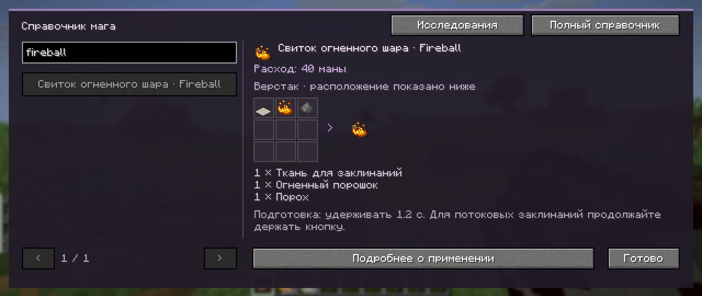
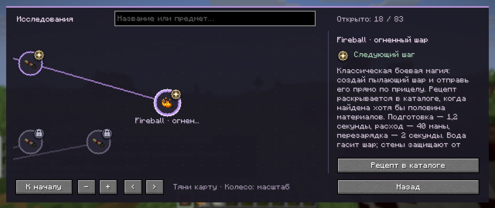

# 0.31 — Fireball и усиленный Nobu

## Fireball

Новое дополнительное заклинание порта, не часть оригинальных 53 ритуальных семейств.

- Возьмите свиток, наведитесь, удерживайте ПКМ **1,2 секунды**, отпустите после готовности. HUD показывает название, подготовку и перезарядку. При ранней отмене мана и свиток сохраняются.
- Успешный выстрел расходует **40 маны** и один обычный свиток. В Mystic Code используется выбранный слот; First Sorcery сохраняет загруженный свиток. Перезарядка **2 секунды**, общая для прямого применения и Mystic Code.
- Базовый прямой урон **12**, горение **4 секунды**. Остальные цели в радиусе **3 блоков** получают до **8 урона**, уменьшающегося к краю. Прямая цель не получает взрыв повторно. Броня и нативные ограничения урона действуют.
- Стены останавливают снаряд и закрывают от взрыва. Вода тушит шар; огнестойкость и огнеупорные существа защищают от урона. Учитываются правила дружеского огня и запреты урона.
- Блоки и постройки не разрушаются, огонь на земле не появляется. Максимальный полёт — **96 блоков** или **80 игровых тактов**; незагруженные чанки не загружаются. Владелец, движение и остаток срока сохраняются.
- Рецепт бесформенный: **магическая ткань + огненный порошок + порох → один свиток**. Каталог раскрывает его после двух из трёх материалов; ванильная книга рецептов — после всех трёх. Свиток включён в существующую систему добычи сокровищниц.
- Огненные спирали подготовки, объёмное светящееся ядро с ореолом и хвостом, вспышка, искры, огонь и дым при попадании. Два собственных синтезированных звука дополняют огненный запуск и взрыв. Прежние звуки сохранены побайтно.
- В справочнике появилась глава, в древе — отдельный узел мистической ветки. Всего теперь 46 свитков и 83 узла исследований. Секретность DOOM сохранена.

Команда для тестирования: `/give @s mahoutsukai:scroll_fireball 16`.

## Nobu

Базовый урон пули повышен **с 8 до 12 HP** — как в ручном, так и в автоматическом режиме. Бонус зачарования Power применяется поверх него.

Старое стандартное значение 8 однократно обновляется до 12 при загрузке конфигурации. Перед изменением сохраняется копия `.before-nobu-0.31`; отметка `.nobu-0.31` предотвращает повторную миграцию. Нестандартные исходные значения и последующие ручные настройки сохраняются.

## Проверки

Нативные проверки охватывают оплату, точную границу подготовки и перезарядки, отмену, недостаток маны, Mystic Code, настоящий крафт и расход ингредиентов, открытие рецепта по материалам, реальные столкновения и урон. Отдельно проверяются вода перед целью и цель перед водой в пределах одного шага; вода за оставшейся дальностью не продлевает полёт. Также проверяются сохранение, срок жизни, дальность, незагруженные чанки, стены, сохранность дерева, огнестойкость, запрет урона и дружественная команда.

Для Nobu проверяются миграция с точной резервной копией, сохранение пользовательских настроек и границы значений; реальные обработчики попадания наносят 12 HP без зачарований в обоих режимах. Изменение стандартного урона учтено в сравнении с оригиналом как явное изменение 8 → 12, без исключения остальных настроек.

Сборка и оба нативных набора прошли. Свежие эталоны заново получены на оригинальном NeoForge JAR: 1 372 ритуальных сценария и 15 440 боевых случаев. Fabric-сравнение прошло с ранее документированными отличиями Clarent, цветов и пользовательских настроек. Новое заклинание проверяется отдельно от оригинальных предметов. Готовый JAR дважды запущен с Fabric API на копии старого мира; сохранение и перезапуск прошли, исходный мир не менялся.

При проверке обнаружена зависимость тестовой сцены от загрузки чанков: добавленная сущность ещё не попадала в запрос до начала нативного отслеживания сущностей. Проверки стрельбы перенесены после настоящих мировых тактов и обработки принудительной загрузки. Строгие проверки количества снарядов, расхода, урона и времени сохранены.

Живой клиент подтвердил загрузку 112 событий кастов/DOOM и геометрию всех 46 свитков, включая новый снаряд (188 вызовов построения). Проверены поиск, масштабирование, возврат в каталог, рецепт, глава и узел Fireball. Визуальные печати вокруг тела скрываются вплотную к камере от первого лица; печать у руки остаётся, а вид от третьего лица показывает полные огненные спирали.

## Снимки из игры

Сборка остаётся экспериментальной. Стоимости указаны для стандартных настроек; броня, эффекты и сторонние моды могут менять итоговый урон. Универсальная совместимость со всеми сторонними модами и шейдерпаками не заявляется.
