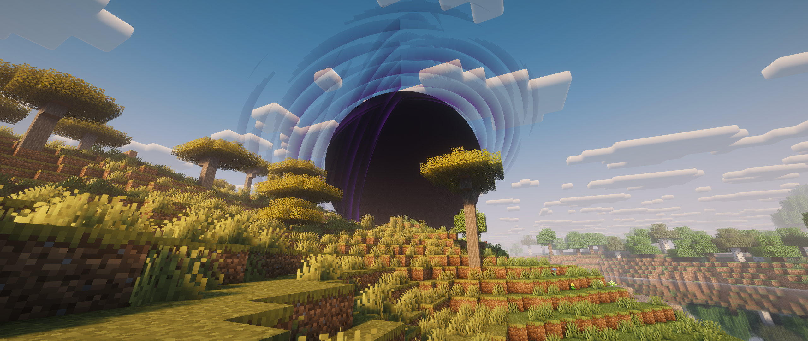

<div align="center">

# 🔮 Mahou Tsukai · Fabric

**Магия, ритуалы и легендарное оружие для Minecraft 26.1.2**


[](https://github.com/DIBERLOG/Mahou-Tsukai-26.1.2-Fabric/releases/latest)

[Установка](#-установка) · [Возможности](#-что-внутри) · [DOOM](#-doom) · [Проверки](#-проверки-и-статус)

</div>



<p align="center"><sub>Реальный игровой кадр DOOM с Complementary. Шейдерпак устанавливается отдельно.</sub></p>

Неофициальный порт **Mahou Tsukai 1.36.36** автора **stepsword** на Fabric с дополнительным заклинанием DOOM. Текущая сборка — **0.30-incomplete**, рабочая экспериментальная версия.

### Новое в 0.30

- **45 свитков — 90 отдельных звуков:** собственная подготовка и активация каждого заклинания, объёмные печати, лепестки, клинки, цепи, короны и разломы. Эффекты учитывают настройку количества частиц.
- **Книга исследований:** 82 связанных шага, поиск, масштабирование, сохранение открытий, новые значки завершения и полный справочник по применению.
- **DOOM — секретное исследование:** его существование видно в игре, но составляющие и рецепт скрыты в книге, ванильных рецептах и текущем JEI. Формула опубликована только [в отдельном спойлере на GitHub](docs/DOOM-SECRET-RECIPE.md).
- **Прогресс мага:** свитки увеличения маны из сокровищниц, уровни и регенерация, восстановление от еды и сна. Расход заклинаний уменьшен вдвое.
- **Удобство применения:** название выбранного заклинания, время подготовки и готовность рядом с маной; подсказки включены по умолчанию и отключаются в настройках. Ранняя отмена подготовки не расходует ману.

[Что проверено в 0.30 →](MahouTsukai-Fabric/docs/QA-0.30.md)

## 📥 Скачать мод

Готовые файлы находятся в **[Releases → последний релиз](https://github.com/DIBERLOG/Mahou-Tsukai-26.1.2-Fabric/releases/latest)**, в разделе **Assets**. Для игры скачайте `.jar`.

| Файл | Для чего | Скачать |
|---|---|---|
| **Mahou Tsukai Fabric 0.30** | Основной мод, обязателен | **[Скачать JAR](https://github.com/DIBERLOG/Mahou-Tsukai-26.1.2-Fabric/releases/download/v1.36.36-fabric.0.30/MahouTsukai-Fabric-1.36.36-fabric.0.30-incomplete.jar)** |
| **Jousting Fabric 0.1** | Необязательное дополнение: копья и Rhongomyniad | [Скачать JAR](https://github.com/DIBERLOG/Mahou-Tsukai-26.1.2-Fabric/releases/download/v1.36.36-fabric.0.30/Jousting-Fabric-1.0.12-fabric.0.1-incomplete.jar) |
| **SHA256SUMS.txt** | Контрольные суммы файлов | [Скачать](https://github.com/DIBERLOG/Mahou-Tsukai-26.1.2-Fabric/releases/download/v1.36.36-fabric.0.30/SHA256SUMS.txt) |

`Source code (zip)` и `Source code (tar.gz)` содержат исходники для разработчиков. В папку `mods` устанавливаются готовые JAR из таблицы.

## 🚀 Установка

| Требование | Версия |
|---|---|
| Minecraft | **26.1.2** |
| Fabric Loader | **0.19.5 или новее** |
| Fabric API | **0.155.3+26.1.2** — проверенная версия |
| Java | **25 или новее** |

1. Установите [Fabric Loader](https://fabricmc.net/use/installer/) для **Minecraft 26.1.2**.
2. Скачайте [Fabric API](https://modrinth.com/mod/fabric-api) для этой же версии Minecraft.
3. Скачайте **основной JAR** из раздела выше.
4. Положите оба файла в папку `mods` вашего игрового профиля. В стандартной установке Windows это `%APPDATA%\.minecraft\mods`.
5. Запустите профиль Fabric. При желании добавьте Jousting JAR в ту же папку.

**Для сервера:** установите Fabric Server для 26.1.2, добавьте Fabric API и основной мод в серверную папку `mods`. У игроков и сервера должны совпадать версии мода и Jousting, если он установлен. Сервер запускается на Java 25+.

При первом запуске удобнее создать новый мир. Перед переносом существующего мира сделайте резервную копию. Оригинальный NeoForge JAR в эту сборку устанавливать не нужно.

## ✨ Что внутри

| Направление | Возможности |
|---|---|
| **Заклинания и ритуалы** | 53 оригинальных ритуальных семейства, свитки, магические круги и система маны |
| **Оружие** | Caliburn, Morgan, Clarent, Nobu, Replica, The Ripper, Mystic Code и другие предметы оригинала |
| **Существа и эффекты** | 27 оригинальных типов сущностей, 37 оригинальных эффектов, фамильяры и проекции |
| **Интерфейсы** | Guidebook, Mystic Code, проекторы, HUD и настройки |
| **Необязательные интеграции** | JEI, локальный Fabric-порт Jousting, Apotheosis Adventure Fabric 0.2.1 |
| **Дополнение порта** | DOOM — большая чёрная дыра с анимацией, звуками и ударной волной |

Apotheosis проверен с конкретным неофициальным Fabric-портом; его JAR и зависимости в этот релиз не входят. Подробности: [интеграции](MahouTsukai-Fabric/docs/GAMEPLAY-0.23.md).

## 🌑 DOOM

Наведитесь на нужную точку, **удерживайте ПКМ 3 секунды и отпустите**. Затем за **8 секунд** вырастает тёмное ядро диаметром до **56 блоков** с вращающимися дисками и стягивающимися частицами, после чего происходит взрыв с ударной волной.

- **Появление:** в точке прицела; выбор неба — до 96 блоков.
- **Поражение существ:** радиус 60 блоков, включая игроков, мобов и самого заклинателя; creative/spectator исключены, тотемы и отдельные запреты урона сохраняются.
- **Разрушение блоков:** радиус 40 блоков; бедрок и защищённые от разрушения блоки сохраняются.
- **Притяжение:** мобы и игроки до 96 блоков во время подготовки; spectator исключён.
- **Детонация:** блоки удаляются в одном серверном такте; на слабом сервере возможна краткая задержка.
- **Перезарядка:** 5 минут при 20 TPS.
- **Стоимость:** 47,5% текущей личной маны; для применения нужны ≥100 маны и ≥95% максимального запаса.
- **Звук появления и взрыва:** короткая запись трипода из «Войны миров» (2005), [источник и сведения о правах](MahouTsukai-Fabric/docs/SOUND-SOURCES.md).

Свиток можно скрафтить. Игра сохраняет его формулу в тайне: [раскрыть рецепт на GitHub](docs/DOOM-SECRET-RECIPE.md). Для тестирования доступна команда:

```mcfunction
/give @s mahoutsukai:scroll_doom
```

[Полное описание, ограничения и проверки DOOM →](MahouTsukai-Fabric/docs/DOOM.md)

## ✅ Проверки и статус

| Проверка версии 0.30 | Результат |
|---|---|
| Сравнение боевой матрицы с оригиналом | **15 440 случаев**, с 12 явно проверенными отличиями сохранённого заряда Clarent |
| Ритуальные катализаторы | **1 372 сценария**, проверка 53 семейств |
| Новые звуки и эффекты | 110 звуковых событий приняты игровым движком; геометрия всех 45 свитков проверена |
| Секретный DOOM | Реальный крафт и расход ингредиентов; рецепт скрыт в survival и creative |
| Готовый JAR на копии NeoForge-мира | Два запуска с сохранением и перезапуском |

В 16 боевых случаях есть разница округления здоровья менее **0,00001 HP**. Исправленные RGB-цвета 37 эффектов проверяются как намеренное визуальное отличие. Полное совпадение любой комбинации сторонних модов, зачарований, ИИ и сетевых условий пока не подтверждено. Отдельные интеграции Jousting/Apotheosis и сравнение чистой сборки проверялись в 0.25; весь их набор в 0.30 повторно не запускался. Подробные границы проверки доступны в отчётах.

[Проверки и снимки 0.30](MahouTsukai-Fabric/docs/QA-0.30.md) · [Базовая боевая матрица 0.25](MahouTsukai-Fabric/docs/COMBAT-COMPARISON-0.25.md) · [Сравнение ритуалов и реестров](MahouTsukai-Fabric/docs/SCENARIO-COMPARISON-0.24.md)

<details>
<summary><strong>🛠 Сборка из исходников</strong></summary>

Нужна Java 25. На Windows:

```powershell
cd MahouTsukai-Fabric
.\gradlew.bat build
```

На Linux/macOS:

```sh
cd MahouTsukai-Fabric
./gradlew build
```

Готовые JAR находятся в `MahouTsukai-Fabric/build/libs/` и `Jousting-Fabric/build/libs/`. `build` включает локальные проверки. Серверное сравнение с оригиналом запускается отдельно и требует самостоятельно подготовленных локальных эталонов.

Оригинальные JAR, тестовые миры, инструменты, личные вложения и сырые журналы исключены из Git. [README модуля](MahouTsukai-Fabric/README.md).

</details>

## 🐛 Сообщить об ошибке

Создайте [Issue](https://github.com/DIBERLOG/Mahou-Tsukai-26.1.2-Fabric/issues/new) и укажите версию мода, что произошло и как повторить проблему. Приложите журнал `logs/latest.log` и список модов, предварительно удалив личные данные и секреты.

## 🤝 Авторство

**stepsword** — автор оригинальных Mahou Tsukai и Jousting. Этот репозиторий содержит неофициальную Fabric-адаптацию. Пользователь сообщил о разрешении на портирование с сохранением авторства; отдельного документа разрешения в проекте нет.

Оригинальная лицензия — **All Rights Reserved**. Публичная доступность репозитория не предоставляет дополнительную открытую лицензию на исходные код и ресурсы. [Авторство и права](NOTICE.md).
